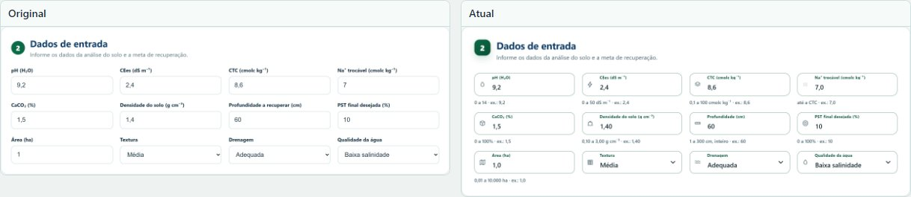
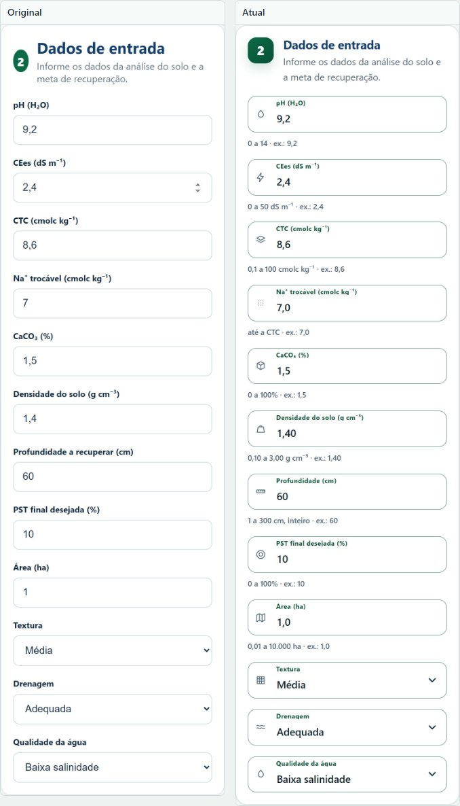
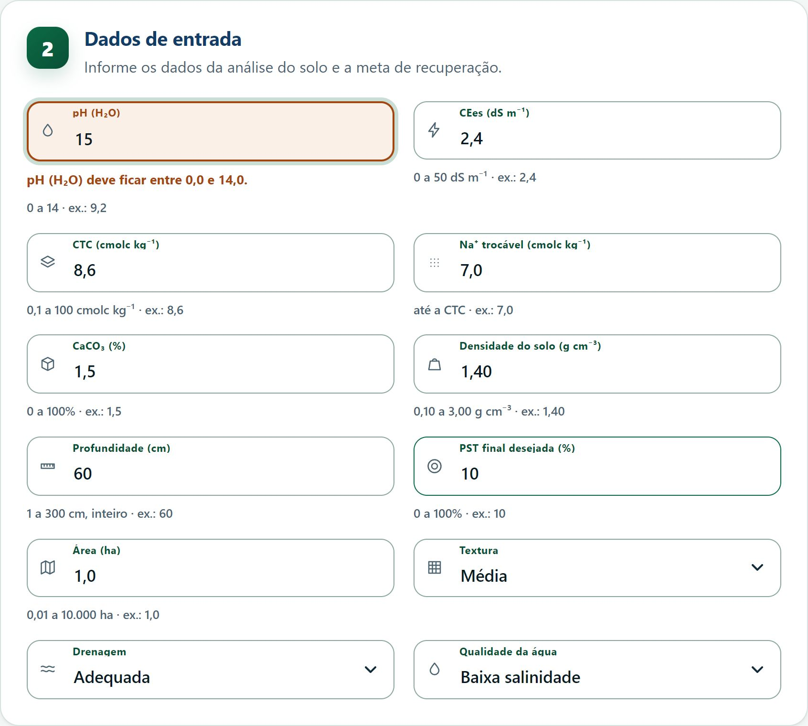
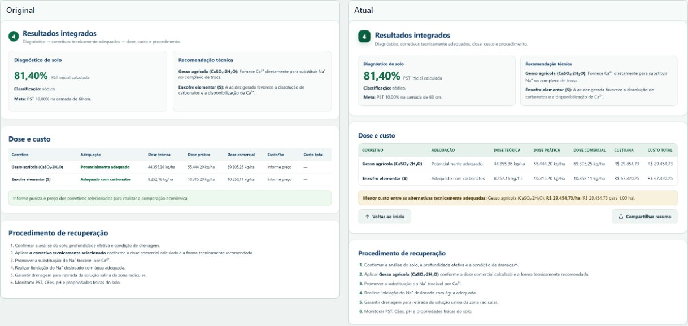
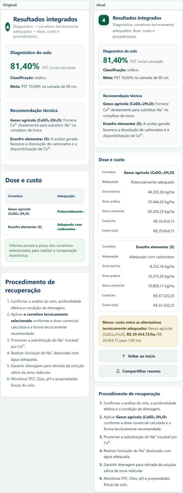

# Original e atual

Comparação com o site que estava no Netlify, preservado em
[`site_original/`](site_original/). Essa é a referência fixa: `npm run prints` refaz as
capturas sempre contra ela.

## Lighthouse

| Verificação | Original | Atual |
|---|---|---|
| Acessibilidade | 0,81 | 1,00 |
| Boas práticas | 1,00 | 1,00 |
| Busca e estrutura | 0,75 | 1,00 |

## Formulário

## Validação em ação

Com pH 15, a versão atual recusa o valor e explica a faixa; o original aceitava
e seguia para o cálculo.

## Resultados

## Comportamento

| Item | Original | Atual |
|---|---|---|
| Digitação | aceita letra e notação científica | só dígitos, vírgula e ponto |
| Colagem | entra como está | recusada com aviso |
| Decimais | sem limite | 0, 1 ou 2 casas por campo |
| Aviso | só no envio | imediato ao digitar valor fora da faixa |
| Preço | obrigatório para calcular | opcional; sem preço, custo não aparece |
| Comparação de custo | qualquer item com preço | exige preço em todos os selecionados |
| Faixas | parciais | todos os campos |
| Erro | genérico | campo, faixa e correção |
| Dicas | ausentes | faixa e exemplo por campo |
| Exemplo | ponto decimal | vírgula |
| Envio | somente pelo botão | botão e Enter no campo |
| Limpeza | imediata | confirmação antes de apagar |
| Ajuda | ausente | seção com fórmulas e coeficientes |
| Compartilhamento | ausente | resumo pelo APK, Web Share ou cópia |
| Retorno | ausente | botão de volta ao início depois do cálculo |

## Aparência

| Item | Original | Atual |
|---|---|---|
| Cabeçalho | alto | compacto, 94 px no computador e 129 px no celular |
| Paleta | cores soltas | tokens semânticos |
| Superfícies | raio de 16 px | raio de 20 px, borda de 1 px e sombra leve |
| Campos | 46 px, label acima | 58 px, texto de 1,08 rem, label flutuante, ícone e texto de apoio |
| Botões | padding de 13 px | 48 px de altura mínima, raio de 12 px e onda de toque, sem o realce quadrado do sistema |
| Tabela | linhas finas | cabeçalho em caixa alta e cartões abaixo de 620 px |
| Tipografia | tamanhos pontuais | escala Material 3 |
| Celular | botão no fim do formulário | barra inferior fixa com a ação principal |
| APK | barra do sistema padrão | barra de status e splash na cor do site |

Paleta atual: fundo `#f3f7f5`, superfície `#ffffff`, texto `#102a3a`, verde
`#0c6b46`, ocre `#9a531e`, azul dos títulos `#123d68`, linha `#d6e2e1`.

## Acessibilidade

- Foco visível em todos os elementos interativos.
- Contraste reforçado por `prefers-contrast: more`.
- Movimento reduzido por `prefers-reduced-motion`.
- Alvos de toque de 44 px nos botões e 48 px nos controles principais.
- Erros ligados por `aria-errormessage` e resultados anunciados por `aria-live`.
- Testes automáticos com axe no fluxo do Playwright.
- Impressão sempre em cores claras.

## Verificação

- 15 testes de unidade e 56 testes de navegador aprovados, incluindo acessibilidade.
- Capturas em `comparacao/`, refeitas contra `site_original/`.
- APK em `apk/dist`, com cópia idêntica em `apk/RECUPERA-SOLO.apk`.

## Preservado

Fórmulas, coeficientes, PE, critérios de classificação, textos técnicos,
estrutura e uso por `file://`.

## Pendência

Textura, drenagem e qualidade da água seguem fora do cálculo.
