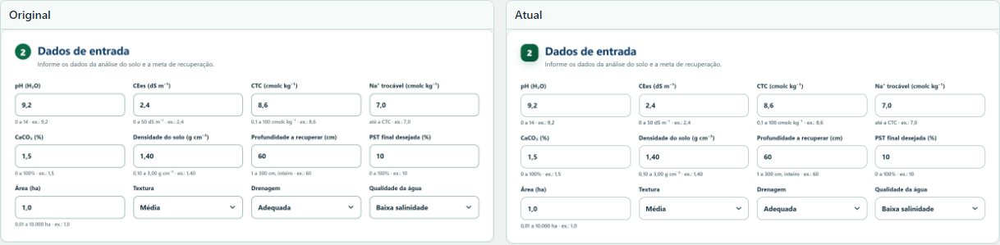
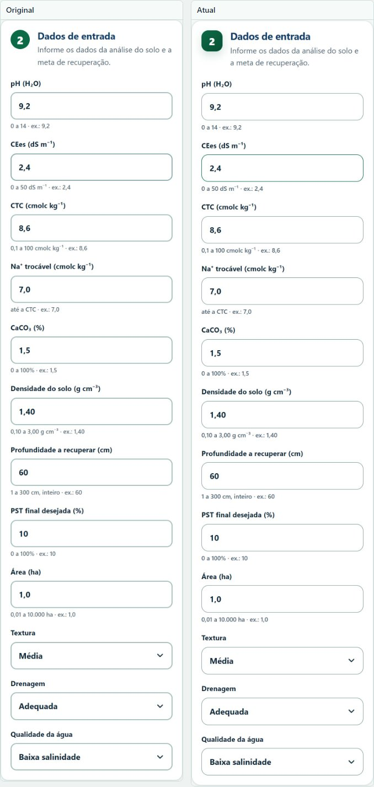
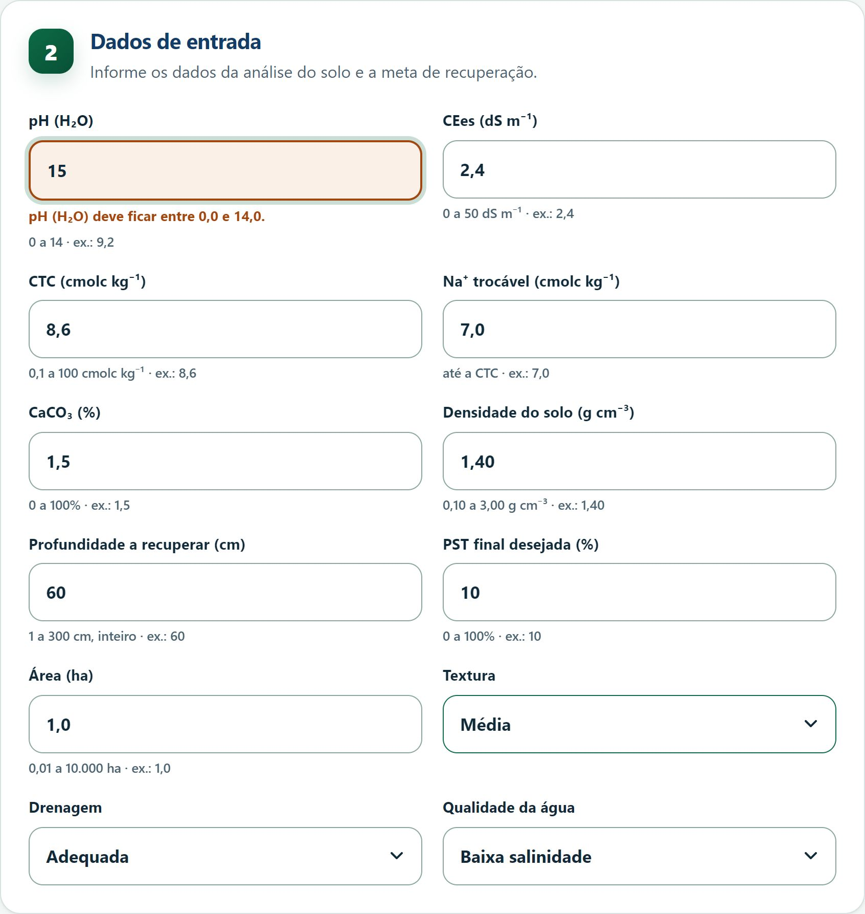
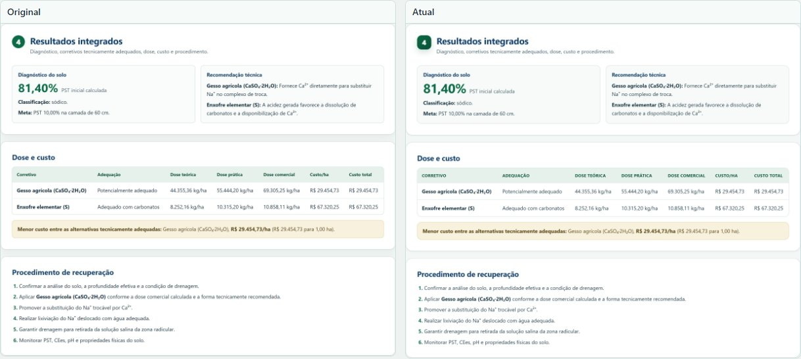
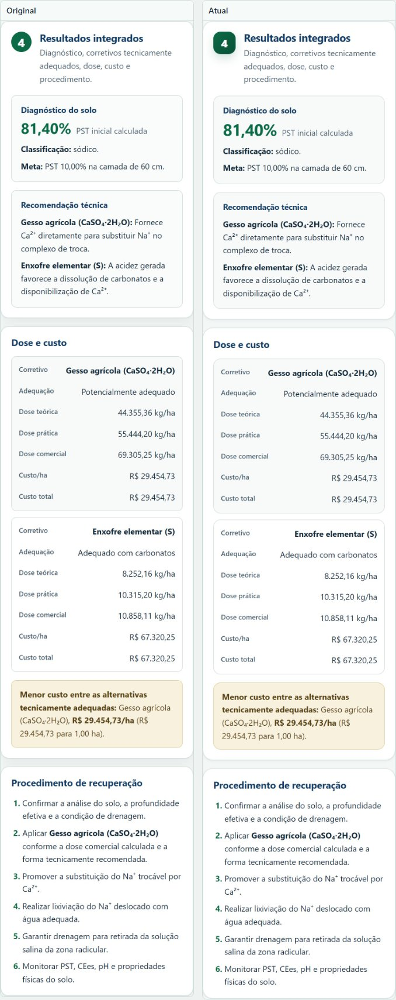

# Original e atual

## Lighthouse

| Verificação | Original | Atual |
|---|---|---|
| Acessibilidade | 0,81 | 1,00 |
| Boas práticas | 1,00 | 1,00 |
| Busca e estrutura | 0,75 | 1,00 |

## Formulário

## Validação em ação

Com pH 15, a versão atual recusa o valor e explica a faixa; o original aceitava
e seguia para o cálculo.

## Resultados

## Mudanças

| Item | Original | Atual |
|---|---|---|
| Digitação | aceita letra e notação científica | só dígitos, vírgula e ponto |
| Colagem | entra como está | recusada com aviso |
| Decimais | sem limite | 0, 1 ou 2 casas por campo |
| Aviso | só no envio | imediato ao digitar valor fora da faixa |
| Preço | obrigatório para calcular | opcional; sem preço, custo não aparece |
| Comparação de custo | qualquer item com preço | exige preço em todos os selecionados |
| Faixas | parciais | todos os campos |
| Erro | genérico | campo, faixa e correção |
| Dicas | ausentes | faixa e exemplo por campo |
| Altura do campo | 46 px | 56 px |
| Borda | 1 px clara | 1,5 px escura |
| Foco | 3 px | 4 px |
| Exemplo | ponto decimal | vírgula |
| Tabela | linhas finas | linhas firmes e cabeçalho destacado |

## Preservado

Fórmulas, coeficientes, PE, critérios de classificação, textos técnicos,
estrutura e uso por `file://`.

## Pendência

Textura, drenagem e qualidade da água seguem fora do cálculo.
