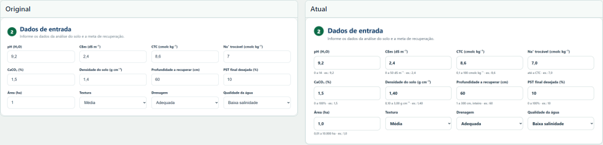
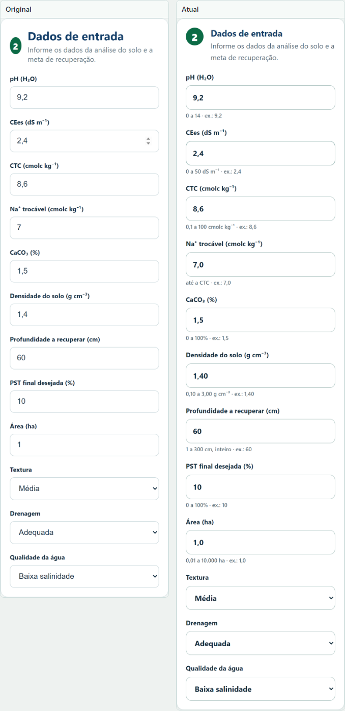

# Mudanças em relação ao original

A comparação é sempre entre o site original e a versão atual. Não há histórico
de versões intermediárias.

## Verificações automáticas

| Verificação | Original | Atual |
|---|---|---|
| Acessibilidade | 0,81 | 1,00 |
| Boas práticas | 1,00 | 1,00 |
| Busca e estrutura | 0,75 | 1,00 |

Medição feita no computador, com o Lighthouse do Chrome, na página inicial.

## Formulário

Computador:

Celular:

## Resultados

Computador:

No celular, a tabela original exige rolagem lateral; a atual usa cartões:

## O que mudou

| Item | Original | Atual |
|---|---|---|
| Digitação | Campo numérico aceita letra e notação científica | Só entram dígitos, vírgula e ponto |
| Colagem | Texto colado entra como está | Colagem com letra é recusada e explicada |
| Casas decimais | Sem limite por campo | Limite por campo: 0, 1 ou 2 casas |
| Faixas | Só pH, CE, PST e alguns mínimos | Faixa e exemplo em todos os campos |
| Mensagem de erro | Texto genérico | Diz o campo, a faixa e o que corrigir |
| Dicas | Ausentes | Faixa aceita e exemplo abaixo de cada campo |
| Altura do campo | 46 px | 54 px, para uso ao sol e com luva |
| Borda do campo | 1 px, cinza claro | 1,5 px, mais escura |
| Foco | Anel de 3 px | Anel de 4 px, mais visível |
| Valor de exemplo | Ponto decimal | Vírgula decimal |
| Erro no campo | Borda e fundo | Borda de 2 px, fundo e texto ligados ao campo |
| Tabela de resultados | Linhas finas | Linhas mais firmes e cabeçalho destacado |

## O que foi preservado

- Fórmulas, coeficientes, PE de cada corretivo e critérios de classificação.
- Textos técnicos do diagnóstico, da recomendação e do procedimento.
- Estrutura de seções e ordem de uso.
- Funcionamento por `file://`, sem servidor e sem bibliotecas.

## Pendência conhecida

Textura, drenagem e qualidade da água seguem sem peso no cálculo, como no
original.
