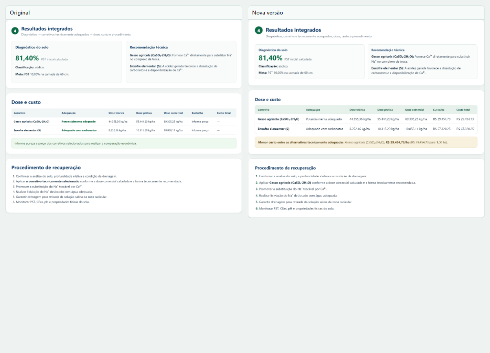
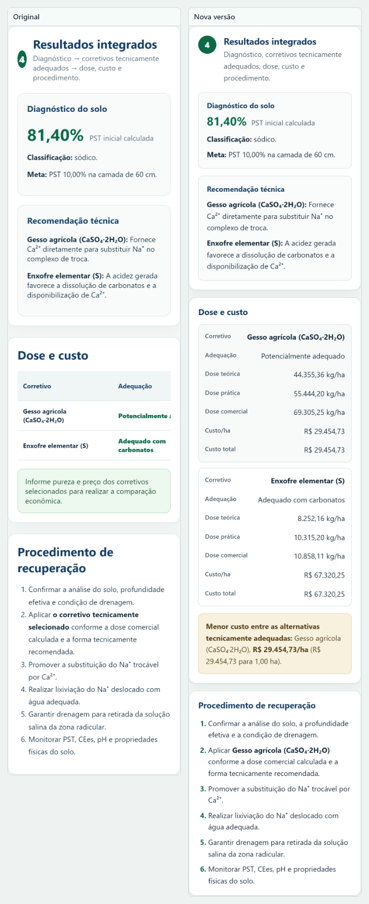

# Mudanças na tela

| Verificação | Original | Cópia |
|---|---|---|
| Acessibilidade | 0,81 | 1,00 |
| Boas práticas | 1,00 | 1,00 |
| Busca e estrutura | 0,75 | 1,00 |

## Celular

Antes, os campos ultrapassavam a borda direita. Depois, o conteúdo cabe na tela.

| Antes | Depois |
|---|---|
|  |  |

## Com e sem Impeccable

A versão com Impeccable recebeu títulos e entrelinha maiores, mais espaço entre
seções, campos de 46 px, valores sem quebra na tabela e caixa de destaque sem
barra lateral. A identidade visual foi mantida.

## Alterações

- Campos empilhados; botões em largura total.
- Títulos de seção maiores, com entrelinha de 1,6 e mais espaço entre seções.
- Texto de abertura em uma linha nas telas largas.
- Tabela de resultados em cartões.
- Erro junto ao campo; resumo com âncoras e foco no primeiro erro.
- Teclado numérico nos campos de número.
- Textos de exemplo mais claros nos campos.
- Campos com altura mínima de 46 px e valores monetários sem quebra.
- Caixa do menor custo em dourado, sem barra lateral colorida.
- Impressão sem botões e sem cabeçalho.

## Pendência

Textura, drenagem e qualidade da água seguem sem peso no cálculo, como no
original. Decisão do autor do sistema.
