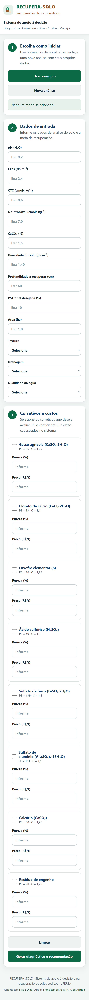
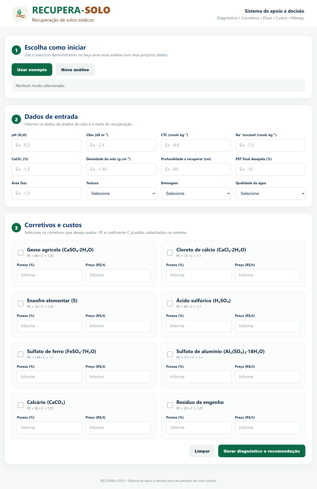
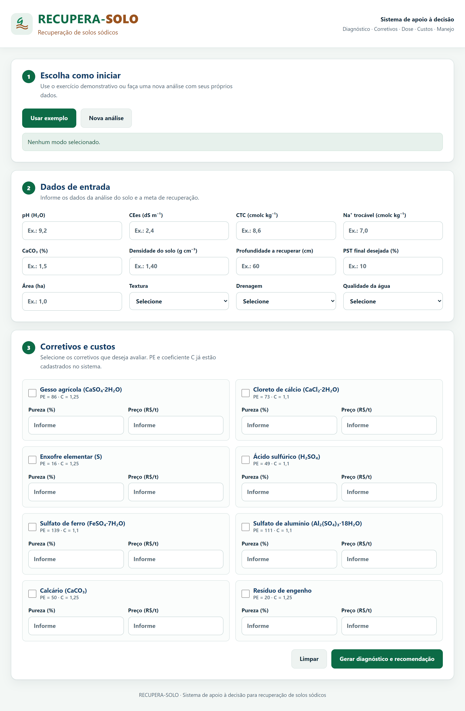

# O que mudou

Cópia do site `https://dapper-flan-955869.netlify.app/` com a tela ajustada para
o celular. O conteúdo, os oito corretivos e o cálculo são os mesmos.

## No celular

Antes, os campos saíam pela direita da tela e a leitura exigia arrastar a
página. Agora nada sai da tela.

| Antes | Depois |
|---|---|
|  |  |

No computador, o desenho foi mantido.

| Antes | Depois |
|---|---|
|  |  |

## Mudanças visíveis

- Os campos descem um para baixo do outro, e os botões ocupam a largura toda.
- A tabela de resultados vira cartões no celular.
- O erro de preenchimento aparece ao lado do campo, no lugar da janela de aviso.
- Os campos numéricos abrem o teclado de números.
- A impressão sai sem botões e sem cabeçalho.

## Testes

| Verificação | Antes | Depois |
|---|---|---|
| Acessibilidade | 0,81 | 1,00 |
| Boas práticas | 1,00 | 1,00 |
| Busca e estrutura | 0,75 | 1,00 |
| Rolagem para o lado no celular | presente | ausente |
| Campos sem nome acessível | não medido | nenhum |

O exemplo indica 81,40% de sódio trocável, classificação sódica, duas linhas de
comparação e seis passos. Com preços de mercado, o enxofre fica em
R$ 20.630,40 por hectare, o menor custo.

## Pendência

Textura, drenagem e qualidade da água continuam sem peso no cálculo, como no
original. A decisão é do autor do sistema.
