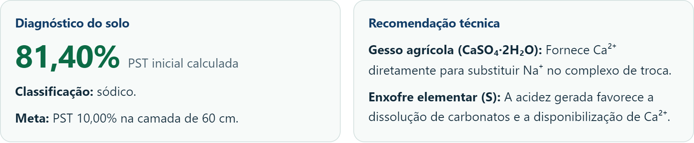
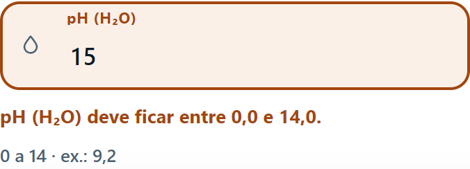

RECUPERA-SOLO: SISTEMA DE APOIO À DECISÃO PARA RECUPERAÇÃO DE SOLOS SÓDICOS

Nildo Dias^1^; Francisco de Assis P. V. de Arruda^1^

^1^ Universidade Federal Rural do Semi-Árido (UFERSA), Mossoró-RN. E-mails: nildo@ufersa.edu.br; xico@ufersa.edu.br. Autor correspondente: Nildo Dias.

Resumo

A recuperação de solos sódicos envolve diagnóstico, escolha de corretivo, dose, custo e procedimento, e a decisão é tomada em campo, muitas vezes sem conexão com a internet. Este trabalho descreve o desenvolvimento e a verificação do RECUPERA-SOLO, sistema de apoio à decisão que reúne essas etapas em página estática e em aplicativo Android. O modelo agronômico original foi preservado e reimplementado em HTML, CSS e JavaScript, sem servidor. A saturação por sódio (PST) é calculada pela razão entre o sódio trocável e a capacidade de troca de cátions (CTC); a dose teórica combina o déficit de saturação, a CTC, o poder de neutralização (PE), a profundidade e a densidade do solo; as doses prática e comercial aplicam o coeficiente de eficiência (C) e a pureza do insumo. Oito corretivos foram cadastrados, com adequação classificada pelo tipo, pelo pH e pelos carbonatos. A entrada de dados recebeu faixas de sanidade, limite de casas decimais e resumo de erros, e a verificação reuniu 15 testes unitários, 56 testes de navegador e auditoria Lighthouse. No caso demonstrativo, a PST inicial foi de 81,4% e o gesso agrícola custou R$ 28.415,15 por hectare, menos da metade do enxofre elementar; o calcário, de menor custo, foi excluído da comparação por baixa prioridade técnica. O sistema orienta a decisão e não substitui a recomendação agronômica.

Palavras-chave: Solos sódicos; Gesso agrícola; Software aplicado; Semiárido; Acessibilidade.

RECUPERA-SOLO: A DECISION SUPPORT SYSTEM FOR SODIC SOIL RECLAMATION

Abstract

The reclamation of sodic soils involves diagnosis, amendment selection, dose, cost and procedure, and the decision is often made in the field without internet access. This paper describes the development and verification of RECUPERA-SOLO, a decision support system that gathers these steps in a static page and an Android application. The original agronomic model was preserved and reimplemented in HTML, CSS and JavaScript, without a server. Sodium saturation (PST) is calculated as the ratio between exchangeable sodium and cation exchange capacity (CEC); the theoretical dose combines the saturation deficit, CEC, neutralizing power (NP), soil depth and bulk density; practical and commercial doses apply the efficiency coefficient (C) and amendment purity. Eight amendments were registered, with suitability classified by type, pH and carbonates. Data entry received range checks, decimal limits and an error summary, and verification included 15 unit tests, 56 browser tests and a Lighthouse audit. In the demonstration case, initial PST was 81.4% and agricultural gypsum cost R$ 28,415.15 per hectare, less than half the cost of elemental sulfur; limestone, the cheapest option, was excluded from the comparison due to low technical priority. The system guides the decision and does not replace agronomic recommendation.

Keywords: Sodic soils; Agricultural gypsum; Applied software; Semiarid; Accessibility.

1 Introdução

Solos afetados por sais e por sódio ocorrem com frequência em áreas irrigadas do semiárido brasileiro, onde a evapotranspiração supera a precipitação e a drenagem é insuficiente. O manejo da irrigação, a qualidade da água e as condições de drenagem controlam o balanço de sais na zona radicular, e o excesso de sódio trocável compromete a estrutura do solo (Dias e Blanco, 2010; Santos et al., 2010). Quando o sódio ocupa o complexo de troca, a argila se dispersa, os poros se obstruem e a infiltração, a aeração e o desenvolvimento radicular são reduzidos. O resultado é a queda de produtividade e o aumento da susceptibilidade à erosão, mesmo quando a concentração total de sais é moderada (Richards, 1954; Embrapa, 2018).

O diagnóstico combina indicadores químicos e físicos. A saturação por sódio (PST) igual ou superior a 15% caracteriza o solo sódico; a condutividade elétrica do extrato de saturação (CEes) igual ou superior a 4 dS m^-1^ indica salinidade, e a presença das duas condições define o solo salino-sódico (Richards, 1954; Embrapa, 2018). O pH e o teor de carbonatos completam a avaliação, porque interferem na escolha do corretivo e na solubilidade dos materiais. A textura, a drenagem e a qualidade da água condicionam a lixiviação e, portanto, o sucesso da recuperação.

A correção exige fonte de cálcio para deslocar o sódio, água para lixiviá-lo e drenagem para retirá-lo da zona radicular. O gesso agrícola dissolve-se e fornece Ca sem elevar o pH; o enxofre elementar e o ácido sulfúrico acidificam o meio e liberam Ca dos carbonatos (Rahman et al., 2022; Albuquerque et al., 2018); o calcário fornece Ca, mas dissolve-se pouco em pH alcalino (Leite et al., 2010; Cavalcanti et al., 2018; Mandal, 2023). A dose depende do poder de neutralização (PE), do coeficiente de eficiência (C), da pureza, da profundidade e da densidade do solo, e o custo depende do preço local e do frete. A escolha entre corretivos combina adequação técnica e custo, e a decisão é tomada em campo, muitas vezes sem conexão.

A eficiência da correção depende da coincidência entre a dissolução do corretivo, o transporte do cálcio até o complexo de troca e a remoção do sódio pela água de lixiviação. Em solos com carbonatos, a acidificação provocada pelo enxofre elementar e pelo ácido sulfúrico aumenta a solubilidade do CaCO~3~ e disponibiliza cálcio; em solos sem carbonatos, a mesma acidificação pode reduzir o pH abaixo da faixa adequada. O calcário, por sua vez, tem solubilidade baixa em pH alcalino e tende a permanecer na superfície, o que explica a prioridade menor nesse cenário (Dias e Blanco, 2010; Tito Sousa et al., 2024).

Ferramentas de apoio à decisão reduzem a dependência de cálculo manual e organizam a informação técnica, mas a adoção depende de interface compreensível, entradas validadas e funcionamento offline (Kumar et al., 2024; Adesiji et al., 2024). A ferramenta de origem, uma página de extensão, aceitava valores impossíveis, como pH 15 e notação científica, exigia preço para qualquer resultado, não indicava faixas e dependia de conexão. A reimplementação do cálculo em um sistema verificável permite preservar o conhecimento agronômico e ampliar a confiabilidade da entrada.

O objetivo deste trabalho é desenvolver e verificar um sistema de apoio à decisão que preserve o modelo agronômico original, assegure entradas válidas, acessibilidade e uso offline, e apresente, para um caso demonstrativo, o diagnóstico, as doses e os custos dos corretivos.

2 Material e Métodos

2.1 Caracterização do estudo

O estudo é aplicado, de desenvolvimento tecnológico, e foi conduzido na Universidade Federal Rural do Semi-Árido (UFERSA), em Mossoró-RN, entre 2025 e 2026. Adotou-se o estudo de caso como estratégia de avaliação, com preservação integral do modelo de cálculo original. Três etapas foram cumpridas: extração do modelo, implementação e verificação. A extração consistiu na leitura das fórmulas, dos coeficientes e dos critérios de classificação; a implementação, na reescrita do cálculo em uma página estática; a verificação, na execução de testes automatizados, auditoria de acessibilidade e comparação com a versão de origem.

2.2 Modelo de cálculo

Fórmulas, coeficientes e valores de PE foram transcritos sem alteração. A PST inicial é a razão entre o sódio trocável e a CTC, em porcentagem. O déficit é a diferença entre a PST inicial e a meta. A dose teórica (DT), em kg/ha, resulta do produto entre o déficit, a CTC (cmol~c~ kg^-1^), o PE (kg de CaCO~3~ por 100 kg), a profundidade (cm) e a densidade (g cm^-3^), dividido por 100. A dose prática (DP) é a DT multiplicada por C, e a dose comercial (DC) é a DP dividida pela pureza. O custo por hectare é a DC, em toneladas, multiplicada pelo preço por tonelada; o custo total é o custo por hectare multiplicado pela área. O PE expressa a quantidade de CaCO~3~ equivalente neutralizada por 100 kg do material, e o coeficiente C corrige a eficiência de campo em função da finura e da reatividade. A pureza converte a dose prática em dose comercial, e o preço converte a dose comercial em custo. A profundidade e a densidade definem a massa de solo corrigida: para uma mesma PST, o aumento da profundidade ou da densidade eleva a dose proporcionalmente.

Oito corretivos foram cadastrados (Tabela 1). A adequação é classificada em três grupos: fontes diretas de cálcio são potencialmente adequadas; fontes ácidas são adequadas quando há carbonatos e exigem cautela quando não há; o calcário recebe baixa prioridade em pH alcalino, pela baixa solubilidade. A classificação do solo combina PST e CEes, e a recomendação técnica acompanha cada corretivo selecionado.

Tabela 1 - Corretivos cadastrados, com tipo, poder de neutralização (PE) e coeficiente de eficiência (C)

| Corretivo | Tipo | PE | C |
|:---|:---|:---:|:---:|
| Gesso agrícola (CaSO~4~·2H~2~O) | Fonte direta | 86 | 1,25 |
| Cloreto de cálcio (CaCl~2~·2H~2~O) | Fonte direta | 73 | 1,10 |
| Enxofre elementar (S) | Fonte ácida | 16 | 1,25 |
| Ácido sulfúrico (H~2~SO~4~) | Fonte ácida | 49 | 1,10 |
| Sulfato de ferro (FeSO~4~·7H~2~O) | Fonte ácida | 139 | 1,10 |
| Sulfato de alumínio (Al~2~(SO~4~)~3~·18H~2~O) | Fonte ácida | 111 | 1,10 |
| Calcário (CaCO~3~) | Baixa solubilidade | 50 | 1,25 |
| Resíduo de engenho | Baixa solubilidade | 20 | 1,25 |

Fonte: dados da pesquisa (2026).

2.3 Implementação e arquitetura

O desenvolvimento seguiu princípios de engenharia de software, com separação entre cálculo, validação e interface (Sommerville, 2019). A página é um único arquivo HTML, com CSS e JavaScript no mesmo diretório, sem servidor e sem banco de dados. O aplicativo Android é empacotado em WebView e assinado por integração contínua, o que permite instalação e uso sem conexão. A ausência de backend mantém os dados no dispositivo e reduz a superfície de ataque. O código é versionado, e os testes são executados a cada alteração. A publicação da página ocorre em serviço de hospedagem estática, e o aplicativo é gerado em fluxo automatizado, com verificação de assinatura e de hash.

2.4 Validação de entradas e acessibilidade

Nove campos numéricos recebem faixas de sanidade, limite de casas decimais e vírgula ou ponto como separador. As faixas adotadas são pH de 0 a 14; CEes de 0 a 50 dS m^-1^; CTC de 0,1 a 100 cmol~c~ kg^-1^; sódio de 0 a 100 cmol~c~ kg^-1^, limitado à CTC; CaCO~3~ de 0 a 100%; densidade de 0,10 a 3,00 g cm^-3^; profundidade de 1 a 300 cm; PST final de 0 a 100%; e área de 0,01 a 10.000 ha. O limite de casas decimais varia de zero a duas, conforme o campo. Letras, sinais e notação científica são recusados; a colagem é verificada; o sódio é comparado à CTC; a pureza é obrigatória e o preço é opcional. O aviso aparece durante a digitação e o resumo de erros indica campo, faixa e correção. A interface foi construída com base na WCAG 2.1, com rótulos associados, foco visível, alvos de toque de 44 px, atributo aria-invalid e resumo de erros navegável (W3C, 2018).

2.5 Verificação

A verificação reúne 15 testes unitários, executados em Node.js, e 56 testes de navegador, executados em Playwright, que cobrem cálculo, validação, acessibilidade e layout. A auditoria Lighthouse compara a versão atual com a original. O protocolo de usabilidade, com nove tarefas e registro de conclusão, tempo, erros e ajuda, foi elaborado para aplicação com produtores e extensionistas, mas não foi aplicado nesta etapa.

2.6 Caso demonstrativo

O caso demonstrativo adota pH 9,2; CEes 2,4 dS m^-1^; CTC 8,6 cmol~c~ kg^-1^; sódio trocável 7,0 cmol~c~ kg^-1^; CaCO~3~ 1,5%; densidade 1,40 g cm^-3^; profundidade 60 cm; meta de PST 10% e área de 1 ha. Os preços de exemplo foram cotados em outubro de 2026, sem frete.

3 Resultados e Discussão

3.1 Diagnóstico

A PST inicial resulta em 81,4%, com déficit de 71,4 pontos percentuais, e o solo é classificado como sódico, pois a CEes é inferior a 4 dS m^-1^. O valor é alto e indica necessidade de correção e de manejo da lixiviação. A ausência de salinidade não reduz a gravidade da sodificação, porque a dispersão da argila depende do sódio trocável e não da concentração total de sais. O resultado é coerente com a literatura, que associa PST elevada à perda de estabilidade estrutural e à redução da condutividade hidráulica (Richards, 1954).

3.2 Doses e custos

A Tabela 2 apresenta as doses e os custos dos três corretivos avaliados.

Tabela 2 - Doses teórica (DT), prática (DP) e comercial (DC), em kg/ha, e custos por hectare e total, em R$, no caso demonstrativo

| Corretivo | Adequação | DT | DP | DC | Custo/ha | Total |
|:---|:---|:---:|:---:|:---:|:---:|:---:|
| Gesso agrícola | Potencialmente adequado | 44.355,36 | 55.444,20 | 69.305,25 | 28.415,15 | 28.415,15 |
| Enxofre elementar | Adequado com carbonatos | 8.252,16 | 10.315,20 | 10.858,11 | 86.843,13 | 86.843,13 |
| Calcário | Baixa prioridade | 25.788,00 | 32.235,00 | 32.235,00 | 8.219,93 | 8.219,93 |

Fonte: dados da pesquisa (2026).

O gesso exige 69.305,25 kg/ha e custa R$ 28.415,15/ha; o enxofre, 10.858,11 kg/ha e R$ 86.843,13/ha; o calcário, 32.235,00 kg/ha e R$ 8.219,93/ha. O calcário tem o menor custo, mas recebe baixa prioridade pela baixa solubilidade em pH 9,2 com carbonatos, e não participa da indicação de menor custo. A exclusão evita a escolha de insumo tecnicamente inadequado. O gesso custa menos da metade do enxofre, o que é coerente com a literatura, que indica o gesso como corretivo de uso corrente na recuperação de solos sódicos (Leite et al., 2010; Cavalcanti et al., 2018; Mandal, 2023). O enxofre elementar, embora eficiente, depende da oxidação microbiana e apresenta custo elevado.

A dose de gesso é elevada e decorre da combinação de PST inicial de 81,4%, meta de 10% e profundidade de 60 cm. A dose é proporcional ao déficit e à massa de solo corrigida; a redução da profundidade para 30 cm, mantidas as demais condições, reduziria a dose comercial pela metade. A pureza também altera o resultado: com pureza de 60%, a dose comercial do gesso passaria de 69,3 t/ha para 92,4 t/ha.

Os resultados obtidos são consistentes com estudos que avaliaram corretivos em solos salino-sódicos. A aplicação de gesso e de resíduos de gesso reduziu a sodicidade e melhorou atributos físicos (Cavalcanti et al., 2018; Yadav et al., 2025); o ácido sulfúrico apresentou efeito semelhante ao gesso em condições controladas (Leite et al., 2010; Albuquerque et al., 2018); formulações de nano-gesso permitiram redução de dose (Abd El-Halim et al., 2022; El-Henawy et al., 2024); condicionadores orgânicos e carvão vegetal também foram avaliados (Karapouloutidou e Gasparatos, 2019; Kanagavalli et al., 2025); e a lixiviação com gesso e biochar foi testada em colunas (Souza et al., 2023).

A dose comercial é sensível à pureza, e o custo, ao preço e ao frete. A indicação de menor custo só é emitida quando todos os corretivos selecionados têm pureza e preço, o que impede que um único preço determine o resultado. A comparação entre corretivos com purezas diferentes exige a conversão para a base comercial, e a ausência dessa conversão é uma fonte comum de erro em cálculos manuais. O sistema mantém a distinção entre dose teórica, prática e comercial, o que torna explícito o efeito da pureza e do coeficiente de eficiência.

3.3 Interface e verificação

A Figura 1 apresenta o diagnóstico e a recomendação gerados para o caso demonstrativo. A Figura 2 mostra o aviso de valor inválido no campo de pH.

Fonte: dados da pesquisa (2026).

Fonte: dados da pesquisa (2026).

Na verificação, pH 15 passou a ser recusado com indicação de campo, faixa e correção, enquanto a versão de origem seguia para o cálculo. Os 71 testes automatizados aprovam cálculo, validação e os requisitos de acessibilidade verificados. A auditoria Lighthouse subiu de 0,81 para 1,00 em acessibilidade e de 0,75 para 1,00 em busca e estrutura. O aplicativo, de 3,5 MB, repete o resultado sem conexão. A Tabela 3 resume a comparação entre a versão de origem e a versão atual.

Tabela 3 - Comparação entre a versão de origem e a versão atual do RECUPERA-SOLO

| Item | Versão de origem | Versão atual |
|:---|:---|:---|
| Letras e notação científica | aceitas | recusadas |
| Valores fora da faixa | aceitos no envio | aviso imediato |
| Casas decimais | sem limite | zero a duas por campo |
| Preço | obrigatório | opcional |
| Comparação de custo | qualquer item com preço | exige pureza e preço em todos |
| Acessibilidade (Lighthouse) | 0,81 | 1,00 |
| Busca e estrutura (Lighthouse) | 0,75 | 1,00 |
| Uso sem internet | não | sim, por aplicativo |

Fonte: dados da pesquisa (2026).

Os resultados confirmam que a validação de entradas reduz erros grosseiros e que o uso offline amplia o alcance em campo. A comparação com a literatura de usabilidade de aplicativos agrícolas indica que a clareza dos rótulos e a previsibilidade das mensagens são determinantes para a adoção (Adesiji et al., 2024; Pliakoura et al., 2018). A avaliação com usuários, no entanto, permanece pendente, e os resultados obtidos até aqui se restringem à verificação técnica e ao caso demonstrativo.

3.4 Limitações

A textura, a drenagem e a qualidade da água não entram no cálculo, como na versão de origem. Os preços são uma fotografia do mercado local, sem frete, e devem ser atualizados a cada safra. O caso é demonstrativo e não substitui experimento de campo. A avaliação de usabilidade foi planejada, mas não aplicada. Essas limitações não invalidam o modelo de cálculo, mas restringem a generalização dos resultados.

4 Conclusão

O RECUPERA-SOLO reúne diagnóstico, dose, custo e procedimento em uma ferramenta que preserva o modelo agronômico original e amplia a confiabilidade das entradas. A decisão é orientada pelo sistema, não substituída por ele: textura, drenagem e qualidade da água permanecem fora do cálculo, e os preços refletem cotação local, sem frete. A verificação técnica confirmou o cálculo, a validação e a acessibilidade, e o caso demonstrativo mostrou que o gesso agrícola é a alternativa de menor custo entre os corretivos tecnicamente adequados, com exclusão do calcário pela baixa solubilidade em pH alcalino. A continuidade inclui a aplicação do protocolo de usabilidade e a incorporação das variáveis ausentes.

Referências

Abd El-Halim, A. E. A.; Salama, A. M.; Ibrahim, M. M.; Aiad, M. A.; Shokr, M. Nano-gypsum in low dose improves the physicochemical properties of saline-sodic soil. Archives of Agronomy and Soil Science, v. 69, n. 12, p. 2286-2299, 2022. https://doi.org/10.1080/03650340.2022.2149741

Adesiji, G. B.; Adelowo, J. Y.; Komolafe, S. E.; Adesiji, T. T. Farmers' perceived rating and usability attributes of agricultural mobile phone apps. Smart Agricultural Technology, v. 8, p. 100501, 2024. https://doi.org/10.1016/j.atech.2024.100501

Albuquerque, A. S.; Fonsêca, N. C.; Santos, R. V.; Medeiros, W. P. Atributos químicos em solo salino-sódico e efeito do ácido sulfúrico no crescimento da Prosopis juliflora. Revista de Ciências Agrárias, v. 61, 2018. https://doi.org/10.22491/rca.2018.2811

Cavalcanti, N. S.; Rolim, M. M.; Santos Júnior, J. A.; Barros, M. F. C. Resíduo de gesso na recuperação de solo salino-sódico proveniente de perímetro irrigado do semiárido brasileiro. Irriga, v. 23, n. 3, p. 505-517, 2018. https://doi.org/10.15809/irriga.2018v23n3p505-517

Dias, N. S.; Blanco, F. F. (Org.). Manejo da salinidade na agricultura: estudos básicos e aplicados. Fortaleza: INCTSal, 2010. 472p.

El-Henawy, A.; Khalifa, M.; Gaheen, S.; El-Faramawy, H. Gypsum and nano-gypsum effects on certain soil characteristics and sorghum yield under saline-sodic soil conditions. Egyptian Journal of Soil Science, v. 64, n. 3, 2024. https://doi.org/10.21608/ejss.2024.283535.1749

Embrapa. Sistema brasileiro de classificação de solos. 5. ed. Brasília: Embrapa, 2018. 356p.

Kanagavalli, A.; Sherene Jenita Rajammal, T.; Baskar, M.; Vanniarajan, C.; Parthasarathi, R.; Selvamurugan, M. Exploring the sodicity reclamation efficiency of coalchar. Journal of Soil Salinity and Water Quality, v. 17, n. 2, p. 173-180, 2025. https://doi.org/10.56093/jsswq.v17i2.167290

Karapouloutidou, S.; Gasparatos, D. Effects of biostimulant and organic amendment on soil properties and nutrient status of Lactuca sativa in a calcareous saline-sodic soil. Agriculture, v. 9, n. 8, p. 164, 2019. https://doi.org/10.3390/agriculture9080164

Kumar, J.; Patel, N.; Sahoo, P. K.; Sudhishri, S.; Yadav, R.; Vibhute, S. D. Development of sensor and decision support system (DSS)-based automated irrigation system for enhancing water productivity of tomato crop. Journal of Soil Salinity and Water Quality, v. 16, n. 2, p. 307-316, 2024. https://doi.org/10.56093/jsswq.v16i2.156426

Leite, E. M.; Diniz, A. A.; Cavalcante, L. F.; Gheyi, H. R.; Campos, V. B. Redução da sodicidade em solo irrigado com a utilização de ácido sulfúrico e gesso agrícola. Revista Caatinga, v. 23, n. 2, p. 110-116, 2010. https://periodicos.ufersa.edu.br/caatinga/article/view/1419

Mandal, A. K. Necessity for quantified measurement of soil sodicity and selection of suitable gypsum amendment for proper reclamation of sodic soils. Pedosphere, v. 33, n. 1, p. 231-235, 2023. https://doi.org/10.1016/j.pedsph.2022.06.038

Pliakoura, A. P.; Beligiannis, G.; Kontogeorgos, A. Mobile device applications usability assessment: the example of an agricultural management application. Journal of Agricultural Informatics, v. 9, n. 3, 2018. https://doi.org/10.17700/jai.2018.9.3.460

Rahman, R. M. A.; Manikandan, K.; Prabhaharan, J. D.; Shenbagavalli, S.; Deepana, P. Efficacy of sulphuric acid and gypsum amendments on sodic soil reclamation under various water regimes. Agrochimica, v. 66, n. 2, p. 169-181, 2022. https://doi.org/10.12871/000218572022235

Richards, L. A. (Ed.). Diagnosis and improvement of saline and alkali soils. Washington: USDA, 1954. 160p. (Agriculture Handbook, 60).

Santos, R. V.; Cavalcante, L. F.; Vital, A. F. M. Interação salinidade-fertilidade do solo. In: Gheyi, H. R.; Dias, N. S.; Lacerda, C. F. (Ed.). Manejo da salinidade na agricultura: estudos básicos e aplicados. Fortaleza: INCTSal, 2010. cap. 6, p. 83-92.

Sommerville, I. Engenharia de software. 10. ed. São Paulo: Pearson, 2019. 768p.

Souza, J. J.; Farias, C. S.; Santos, D. B.; Lima, R. M. Efeito da lixiviação sob a solução do solo salino-sódico enriquecido de gesso agrícola e biochar. Cadernos Macambira, v. 8, n. especial 1, p. 231-237, 2023. https://doi.org/10.59033/cm.v8iespecial1.1150

Tito Sousa, I.; Ferraz, D. S.; Carvalho, R. L.; Silva, A. M. Atuação de diferentes corretivos na recuperação de solo salino-sódico cultivado com Pithecellobium dulce (Roxb.) Benth. Revista Brasileira de Geografia Física, v. 17, n. 1, p. 626-637, 2024. https://doi.org/10.26848/rbgf.v17.1.p626-637

World Wide Web Consortium (W3C). Web Content Accessibility Guidelines (WCAG) 2.1. Cambridge: W3C, 2018. Disponível em: https://www.w3.org/TR/WCAG21/. Acesso em: 22 out. 2026.

Yadav, R.; Kumar, K.; Kumari, K.; Prakash, R.; Singh, A. Effect of gypsum and zinc on performance and nutrient content of wheat crop under sodic water irrigation. Journal of Soil Salinity and Water Quality, v. 17, n. 1, p. 27-34, 2025. https://doi.org/10.56093/jsswq.v17i1.166341
